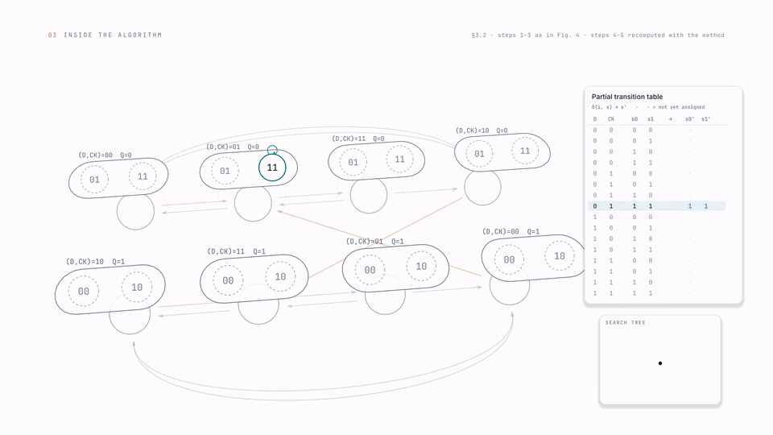
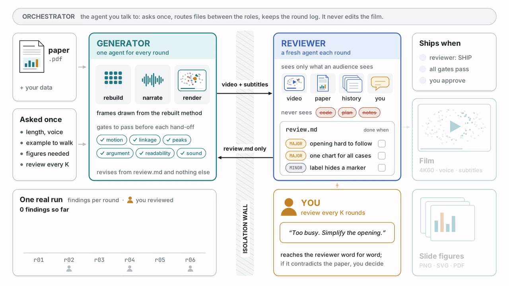
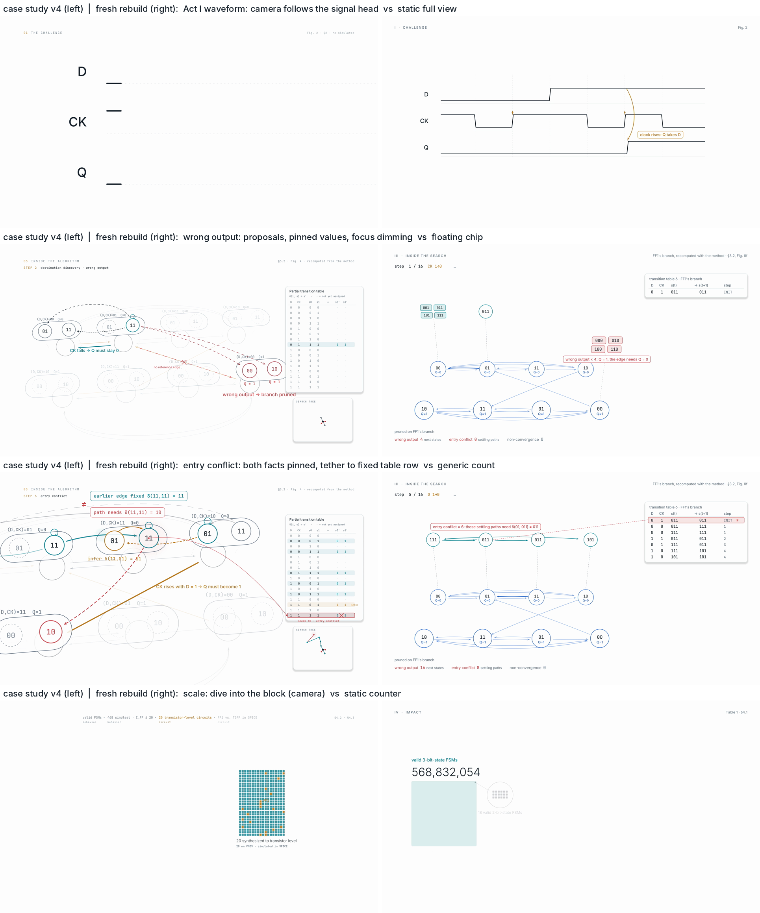
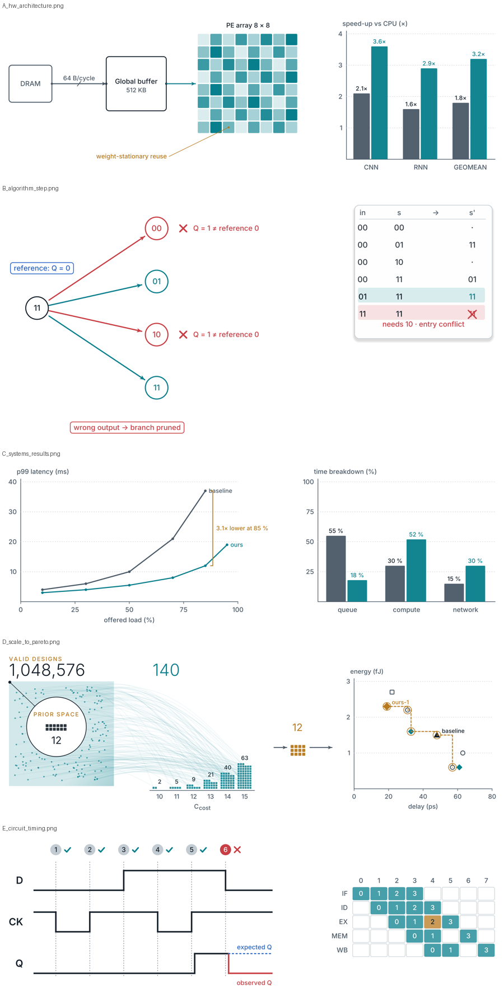

<div align="center">

# papercinema

**Your paper as cinema, not slides.**

A Claude Code skill that turns a CS/EE research paper into a narrated, code-rendered explainer film (4K60) and matching slide figures. It rebuilds the paper's method so the mechanism moves on screen, stages the key results as planned moments without overstating them, and has an independent reviewer agent check every cut against the paper.

[](LICENSE)




<sub>17 s from the film it made for B-Flex (DAC 2026): the search prunes a wrong-output branch, then the 3-bit result lands. Every frame is drawn in code from the paper's method. The full 2-minute film is below.</sub>

</div>

### The full film

<!-- FILM: in GitHub's web editor, drag readme_media/bflex_film_1080p30_github.mp4 (8.9 MB, under the 10 MB limit) onto the line below this comment; GitHub turns it into an inline player. Then delete this comment. -->

*B-Flex: Exploration of Broader Flip-Flop Design Space Based on FSM Exhaustive Search (DAC 2026). 119 s, narrated and subtitled, mastered at 4K60. The production this skill was distilled from. Also on [LinkedIn](LINKEDIN_POST_URL).*

---

## Not slides with a voice-over

Tools such as [Paper2Video](https://arxiv.org/abs/2510.05096) and [ResearchStudio-Reel](https://microsoft.github.io/ResearchStudio/reel-page/) automate the *talk*: slides built from the paper, narration, and an avatar, cursor or highlights. papercinema makes an *explainer film*, and that changes three things.

| | Talk-video tools | papercinema |
|---|---|---|
| **The mechanism** | described on a slide, with the paper's static figures | rebuilt and checked against the paper's worked examples, then animated from its own trace: what each unit computes, what each buffer holds, element by element |
| **The strengths** | a bullet or a chart | 3–6 planned peaks (setup → tension → reveal → hold), with the sound and the key word landing on the reveal. A peak never overstates its claim, and every result shows its trade-off within seconds. |
| **The concepts** | separate pictures for separate ideas | one visual spine carried from the hook to the result; every finding is pinned to the element it is about |
| **Checking** | none | an independent reviewer compares every cut with the paper; you review every K rounds |

## What you get

- **A film**: 4K60 and 1080p60, voice-over, subtitles and a mastered mix (−16 LUFS). Every frame is drawn in code (pycairo): no stock footage and no generated video.
- **Faithful to the paper**: every number carries its scope and conditions on screen. Illustrative visuals are labelled as illustrations.
- **Slide figures** in the same visual style, as PNG, SVG and PDF, composed for slides rather than captured from the animation.
- **An audit mode**: give it an existing film and the paper, and it checks one against the other.

## Install

**Claude Code (plugin marketplace)**

```text
/plugin marketplace add JeongHyunsung/papercinema
/plugin install research-paper-film@papercinema
```

**Manual**: copy `skills/research-paper-film/` to `~/.claude/skills/research-paper-film/`.

**Claude apps**: zip `skills/research-paper-film/` and upload it under Settings → Capabilities → Skills.

Then attach your paper and ask:

> *Make a 2-minute narrated explainer film of this paper.*
> *Make motivation / method / result slide figures for this paper.*
> *Audit this film against the paper.*

At the start it asks you once: length, narration, which example to walk through, which figures you need, and how often you want to review (every K rounds).

## How it works: nobody grades their own work



<sub>The harness, running one real production: 6 rounds, 46 findings, all closed. Static version: <a href="docs/assets/harness.png">harness.png</a>. Drawn in code in the films' own style: <a href="docs/assets/src/harness_hero.py">harness_hero.py</a></sub>

An agent that makes a film and then reviews it sees what it meant, not what is on screen. So the work is split into the roles in the diagram above.

- The **orchestrator** is the agent you talk to. It asks the intake questions once, routes files between the roles and keeps the round log. It never edits the film, and it never paraphrases one role's output to another.
- The **generator** builds every cut. It reads the paper, rebuilds the method and asserts it against the paper's worked examples, writes the script, records the voice, retimes the picture to the speech, renders and mixes. Before each hand-off it must pass measurable gates: motion, linkage, peaks, argument, readability and sound.
- The **reviewer** is a new agent every round. It sees only what an audience would: the video, the subtitles, the paper, any data you supplied, its own earlier reviews and your comments. It never sees the generator's code, plan or notes. It returns `review.md`: a verdict, findings by severity, and a checkable "done when" for each.
- **You** review every K rounds. Your comments reach the reviewer word for word, and the generator meets them only through the review. When feedback would contradict the paper, the question comes back to you; it is never silently applied or ignored.
- Either agent can ask you for data (the numbers behind a plot, a run log). "There is none" is a valid answer.

## Does the loop pay off?

From the first production with the review loop (on a paper not yet published; its full record will be added once the paper is public):

| | |
|---|---|
| Rounds | 6 film rounds, with the author reviewing rounds 2, 4 and 6 |
| Findings | 46: 1 BLOCKING · 20 MAJOR · 25 MINOR. 14 came from the author's comments, the rest from the reviewer. |
| Example BLOCKING finding | a mechanism drawn in a way that contradicted the authors' own run data, caught in round 1 |
| Outcome | every finding fixed or closed by the author's ruling; reviewer SHIP and author approval in round 6 |
| After that | 4 rounds on the slide figures and 3 delivery checks of the rendered files |

The rules the skill follows today come from real feedback. The B-Flex film took five versions and two rounds of figure feedback. A later from-scratch rebuild was more accurate but visibly static, and that gap became the motion and linkage gates ([postmortem](skills/research-paper-film/examples/bflex/docs/FRESH_REBUILD_POSTMORTEM.md)):



See [CHANGELOG.md](CHANGELOG.md) for what each version fixed.

## Slide figure gallery

Five example figures for different kinds of paper, built from `scripts/viz_kit.py` with toy data:



The skill covers seven paper archetypes: algorithms and search, hardware and accelerators, circuits and devices, systems, ML, compilers / PL / security, and signal processing / control. For each one it defines the worked example, the mechanism beat, the result visuals, the conditions every number needs, and the wording traps to avoid ([references/13](skills/research-paper-film/references/13-paper-archetypes.md)).

## Requirements

- Python 3.10+, ffmpeg with libx264, poppler-utils (`pdftoppm`, `pdffonts`)
- `pip install -r skills/research-paper-film/requirements.txt`
- Fonts: Inter (OFL), optionally JetBrains Mono. Run `python3 skills/research-paper-film/scripts/figures/setup_fonts.py` once.
- Models (not bundled; both Apache-2.0):

  | Model | Get it from | Set |
  |---|---|---|
  | Kokoro-82M v1.0 (voice) | `kokoro-v1.0.onnx` and `voices-v1.0.bin` from the `thewh1teagle/kokoro-onnx` release `model-files-v1.0` | `KOKORO_DIR` |
  | sherpa-onnx zipformer `sherpa-onnx-zipformer-en-2023-06-26` (speech recognition for alignment and checks) | `k2-fsa/sherpa-onnx` release `asr-models` | `SHERPA_DIR` |

**Time and cost.** Expect hours, not minutes. In the production above, the first cut took about 70 minutes of agent time and each revision roughly 15–40 minutes, plus your review time. It is a long agent workflow and uses a large model budget.

## Smoke test

```bash
export KOKORO_DIR=/path/to/kokoro SHERPA_DIR=/path/to/sherpa-onnx-zipformer-en-2023-06-26
bash skills/research-paper-film/examples/minimal/run_demo.sh
```

This renders an 11 s toy film through the whole pipeline (narration, alignment, retime, audio mix, chunked render, assembly, subtitle and loudness checks, gates, slide figures, figure lint) and ends with `GATES PASS`, `LINT PASS` and `demo OK`.

## Principles

- Fidelity over spectacle, and aim for both. Nothing is invented; illustrative visuals are labelled.
- Numbers carry their conditions: units, baselines, scope, spread.
- Drama never strengthens a claim.
- Speech is never time-stretched; the picture is retimed to the voice.
- Audio is licence-clean: a procedural score and SFX, open-licence voice models.
- Never claim a check that was not run.

## Repository layout

```
.claude-plugin/              plugin and marketplace manifests
docs/assets/                 the film teaser GIF, the harness graphic (PNG, GIF, MP4) and the script that draws it
skills/research-paper-film/  the skill: SKILL.md, references/, scripts/, templates/, examples/
CHANGELOG.md                 what each version fixed
docs/STRUCTURE.md            every file in the skill, one line each
```

## License

MIT for the code and docs in this repository. Paper content quoted in `examples/bflex/docs` belongs to its authors. Models and fonts keep their own licences.
