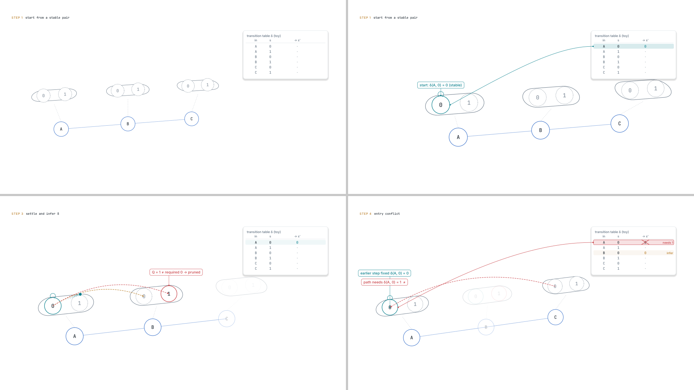

# motion_kit demo (12 s, toy data)

One mechanism beat choreographed with `scripts/motion_kit.py`, the way the case study did it:
- pills holding the full candidate space;
- a camera that pushes in to each step and pulls back (`beat_keys`);
- focus dimming;
- proposal arcs, then a tracer on the accepted settling path;
- a fixed-address table written in place, with a tether from the node to the row;
- findings pinned with values (`callout_at`);
- an entry conflict that shows the earlier fact and the needed fact side by side.



```bash
cd examples/motion_kit_demo
PYTHONPATH=../../scripts python3 ../../scripts/render.py video --w 640 --fps 30 --out out/demo.mkv
python3 ../../scripts/motion_audit.py out/demo.mkv --json out/motion.json
python3 ../../scripts/gate.py --no-edl --motion out/motion.json          # G1-G4: PASS
PYTHONPATH=../../scripts python3 ../../scripts/linkage_audit.py film \
    --allow "^(STEP|start from|destination|settle and|entry conflict$)"  # L1: PASS
```

Measured: static 0 %, longest static 0 s, camera 75 %, mean change 3.0 %; 0 unanchored findings, 11 anchored strings.
