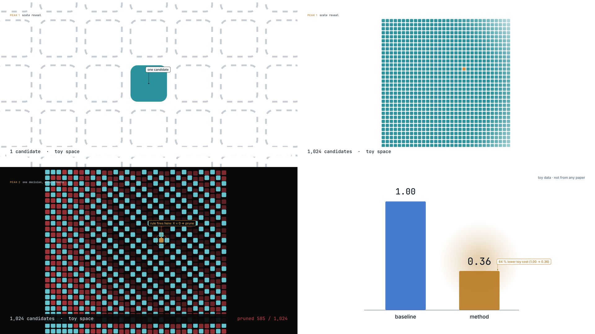

# peak_kit demo (30 s, toy data)

Three planned peaks (references/15), built with `scripts/peak_kit.py`:

| Peak | Kind | Device | Reveal | Signature |
|---|---|---|---|---|
| whole toy space appears | hook | scale_reveal: one candidate, log-zoom out, the space lights up from it | 3.0 s | — |
| one rule prunes 60 % in a ripple | concept | cascade from the rule's cell, exact counter | 12.0 s | night |
| 64 % lower toy cost | result | number_land (no overshoot), trade-off pinned 2 s later | 24.0 s | accent |

Two signature breaks: the whole per-film budget. Each peak has a riser, 350 ms of pre-hit silence and one hit on the reveal.



```bash
cd examples/peak_demo
PYTHONPATH=../../scripts python3 ../../scripts/render.py video --w 640 --fps 30 --out out/demo.mkv
PYTHONPATH=../../scripts python3 film.py                     # out/peaks.json, out/cues.json, out/audio.wav
python3 ../../scripts/wow_audit.py --peaks out/peaks.json --video out/demo.mkv \
    --cues out/cues.json --ledger LEDGER.md --json out/wow.json          # W1-W7: PASS
python3 ../../scripts/motion_audit.py out/demo.mkv --json out/motion.json
python3 ../../scripts/gate.py --no-edl --motion out/motion.json --wow out/wow.json   # GATES PASS
PYTHONPATH=../../scripts python3 ../../scripts/linkage_audit.py film \
    --allow "^(PEAK|scale reveal|one decision|the result|toy data|[0-9,]+ candidate|pruned [0-9])"  # L1: PASS
python3 neg_test.py                                          # W2, W4, W5, W7 FAIL on a broken plan
```

Measured (640 px, 30 fps): reveal spikes 20.1 / 28.9 / 12.0 % of the frame vs setup medians 0.03–0.22 %; largest change in any hold ≤ 0.7 %; cues 0 ms from reveals; static 0 %, camera 43 %, mean change 15.9 %; 0 unanchored findings.
Toy data, not from any paper. W6 (key word on the reveal) needs narration and is not exercised here.
